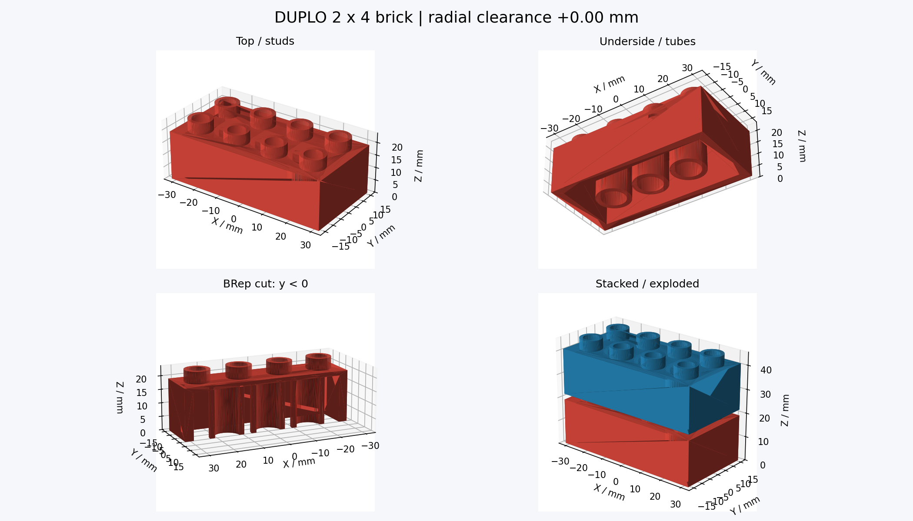

# 3d-printer — デュプロ互換ブロックの設計・検証ハーネス

変則デュプロを作るための、パラメトリックCADと幾何検証の作業環境です。**現在の主対象とCLI既定値はDUPLO 2×4**です。短い試し刷り用2×2もあります。旧試作2×2は実物で接続・遊べたものの、突起がきつい・裏面が緩い・角が痛いという評価。新しい丸角版・レールは実物未検証です。

- [水平レール試作01・丸角2×2試作02（STL ZIP）](prints/duplo_rail_trial_01.zip) — [寸法・印刷・確認手順](docs/duplo-rail-trial-01.md)

- [次の印刷：DUPLO通常高さ2×2（突起2番＋受け3番）](examples/duplo-fit-trial-01/brick.stl) — [印刷・確認手順](docs/duplo-fit-trial-01.md)
- [初回のDUPLO接続校正プレート（補正違いの低い2×2を5個、PLA換算約26.6 g）](examples/sim2real-duplo/plate.stl) — [印刷・評価手順](docs/sim2real-duplo.md)
- [印刷用STL 2種類をまとめてダウンロード（ZIP）](prints/duplo_bricks.zip)
- [DUPLO 2×4 STL](examples/duplo-2x4/brick.stl) — 本体63.8×31.8×19.2 mm
- [DUPLO 2×2 STL](examples/duplo-2x2/brick.stl) — 本体31.8×31.8×19.2 mm
- [寸法の根拠・作成手順](docs/duplo.md)

STLは既にデュプロ寸法です。スライサーではmm単位・100%で読み込み、さらに2倍に拡大しないでください。

通常サイズのレゴ用モデルは`examples/first-print/`と旧profileに残しています。



## 新規セッションで再開する

[新規セッションからの起動手順](docs/new-session.md)に、依存の確認・Chromium導入・常駐起動・撮影・CAD再生成までまとめています。前セッションのブラウザや一時ファイルは不要です。

## できること

- Pythonから寸法を変更して、裏面チューブ付きのブロックを生成。
- STL（印刷用）とSTEP（CAD編集用）を書き出し、ファイル自体も検査。
- CADの単一実体・寸法・体積・開口・スタッド・チューブを検査。
- 重ねる・1ピッチずらす・90度交差する姿勢で、BRepの共通体積を計算。
- 挿入方向の5姿勢と、公差の違う5候補を確認。
- 実際の形状の断面PNGと、オフラインで回転できるHTMLを生成。
- Chromiumでビューアーを操作し、上面・裏面・CAD断面・組立・干渉例・モバイル画面を実際に撮影。
- GitHub ActionsでCADとブラウザを再検証し、スクリーンショット・trace・レポートをartifactに保存。

## 以前の通常レゴ試作品を見る

`examples/first-print/`に生成済みの一式を置いています。

- [`brick.stl`](examples/first-print/brick.stl) — 半径方向+0.05 mmの未校正候補。
- [`brick.step`](examples/first-print/brick.step) — 他CADへ渡す形状。
- [`viewer.html`](examples/first-print/viewer.html) — ダウンロードしてブラウザで開く。GitHub上の表示はソースコードです。
- [`report.json`](examples/first-print/report.json) — 寸法、検証結果、干渉量、使用バージョン、出力ハッシュ。
- [`calibration/`](examples/first-print/calibration/) — 5種類の試し刷りSTLと実測用テンプレート。

`preview.png`の組立図は見やすいように2.5 mm浮かせています。HTMLでは追加高さ0 mmに戻して組立状態を確認できます。相手は合成の名目モデルです。純正をスキャン・実測したものではありません。

## 再生成

Python 3.11を使用します。MacではまずPython 3.11を用意し、以下をrepoのルートで実行してください。

```sh
python3.11 -m venv .venv
source .venv/bin/activate
python -m pip install -r requirements.txt
python -m unittest discover -s tests -v
python -m brickcad all
open build/duplo-2x4/viewer.html
```

Mac以外では最後のHTMLをブラウザで開いてください。主要なCAD・数値計算・描画依存はバージョン固定していますが、全推移依存のlockfileではありません。検証時の実バージョンはレポートに残します。

```sh
# 合成の名目寸法モデル
python -m brickcad build --profile profiles/duplo-nominal.json --out build/duplo-nominal

# 公差5候補のSTL・比較結果・計測テンプレートだけ生成
python -m brickcad sweep --profile profiles/duplo-first-print.json --out build/trial
```

寸法変更はJSON profileを追加して`--profile`で指定します。省略した項目は`brickcad/model.py`の既定値です。現在の対応範囲は両軸2〜12スタッドの長方形です。例えばDUPLO 2×3は`{"family":"duplo","nx":3,"ny":2,"clearance":0.0}`。family省略時は既存互換性のため通常レゴ寸法。

```text
brickcad/model.py       CAD生成・寸法定義
brickcad/verify.py      BRep・STL・組立の検証
brickcad/render.py      CAD断面画像・HTML生成
brickcad/viewer.html    外部ライブラリ不要の3D表示
brickcad/__main__.py    build / sweep / all
profiles/              名目設定と初回印刷候補
examples/first-print/  生成済み試作品・検証結果
measurements/          実測記録（取得後に追加）
tests/                 正常例・欠陥を検出する負例
```

## 「検証済み」の意味

`report.json`の`passed=true`は、CAD/STL/STEPの検査、検査した組立姿勢の無干渉、負例の検出を通ったという意味です。締まり具合・保持力・印刷精度の保証ではありません。負の公差で意図的に食い込ませた候補は、sweep内では正常に生成されても干渉ありと報告します。

次の段階ではプリンター機種・ノズル・材料・スライサーを特定し、試し刷りの実測値からprofileを調整します。[設計の根拠・検証範囲・実測手順](docs/design.md)を参照してください。

## インタラクティブに確認する（通常の開発ループ）

CAD生成後、ブラウザを常駐させます。操作ごとの再起動・push・デプロイ・Actions待ちは不要です。

```sh
npm ci
npx playwright install --with-deps chromium
npm run browser:interactive -- build/duplo-2x4
```

起動後の入力はJSONを1行ずつ渡します。各操作の後に、スクリーンショットの絶対パス・所要時間・画面の検証表示を返します。撮影画像をエージェントが開き、必要な次の操作を判断できます。

```json
{"action":"view","value":"underside"}
{"action":"mode","value":"section"}
{"action":"view","value":"section"}
{"action":"mode","value":"stack"}
{"action":"view","value":"perspective"}
{"action":"lift","value":8}
{"action":"orbit","dx":100,"dy":40}
{"action":"zoom","value":-120}
{"action":"reload"}
{"action":"close"}
```

別のターミナルで`python -m brickcad build`を再実行し、`reload`すると新しいCADが表示されます。`build`は数秒のCAD生成を含みますが、視点・組立の操作ではCADを再生成しません。今回の環境では操作と撮影が約0.17〜0.32秒、再読み込みと撮影が約0.33秒でした。速度は環境で変わります。

標準のブラウザ導入ができないLinux環境では、npm配布のバイナリを使う経路も用意しています。

```sh
npm install --prefix /tmp/brick-browser-runtime --ignore-scripts @sparticuz/chromium@153.0.0
BRICK_CHROMIUM_PACKAGE=/tmp/brick-browser-runtime/node_modules/@sparticuz/chromium/build/index.js npm run browser:interactive -- build/duplo-2x4
```

この経路は圧縮バイナリと描画ライブラリを`build/browser-runtime/`に展開します。tarの所有者変更を行わないため、所有者変更に制約のある環境でも使えます。Linux用の代替経路で、通常のMac/Windowsは標準Playwrightを使います。描画はWebGLの深度バッファを使い、裏側の面が手前へ出る描画順の問題を避けています。日本語UIの必要文字はOFLフォントのサブセットをHTMLへ埋め込んでいます。

[実ブラウザの撮影一覧](examples/browser/review-sheet.jpg)・[目視確認記録](examples/browser/visual-review.md)も参照してください。

## ブラウザでの一括撮影と目視確認（回帰確認）

Node.js 22を用意し、CAD生成後に以下を実行します。

```sh
npm ci
npx playwright install --with-deps chromium
npm run browser:check -- build/duplo-2x4 build/browser-qa
python scripts/review-sheet.py build/browser-qa
```

`build/browser-qa/`に10視点の実ブラウザPNG、一覧用`review-sheet.jpg`、操作を再生できる`trace.zip`、ブラウザバージョン・入力ハッシュ・画像ハッシュ付き`browser-report.json`が残ります。外部CDNから描画ライブラリを読み込まず、生成済みHTMLをChromiumで開きます。

自動検査はJavaScriptエラー、空のキャンバス、組立部品の描画漏れ、視点変更、ドラッグ・拡大縮小、表示上の干渉判定、モバイルの横はみ出しを確認します。形状の意味を理解した目視判定は行いません。`automated_passed`と`visual_review_performed`は別です。画像をエージェントが実際に開いて確認し、欠陥があれば修正・再撮影することが作業完了条件です。

上のLinux用代替経路も使えない場合は、GitHub Actionsの`brick-cad-and-verification` artifactから同じ画像を取り出して確認します。未取得・未確認なら目視確認済みと扱いません。

## 初回のデュプロ接続校正

`python -m brickcad.calibration` はDUPLO 2×2の補正違い5個を生成します。
[印刷プレート](examples/sim2real-duplo/plate.stl)を100%・mm単位・突起上向きで印刷し、純正DUPLOを相手に突起側／受け側を別々に選びます。
[印刷・評価・再生成手順](docs/sim2real-duplo.md)を参照してください。

## 以前の通常レゴ用校正プレート

`examples/sim2real/plate.stl`と`python -m brickcad.calibration --family lego`は、通常レゴ（8 mmピッチ）の接続試験です。DUPLO用ではありません。既存の試験データを残しています。デュプロ用の作成・寸法は[こちら](docs/duplo.md)を参照してください。


