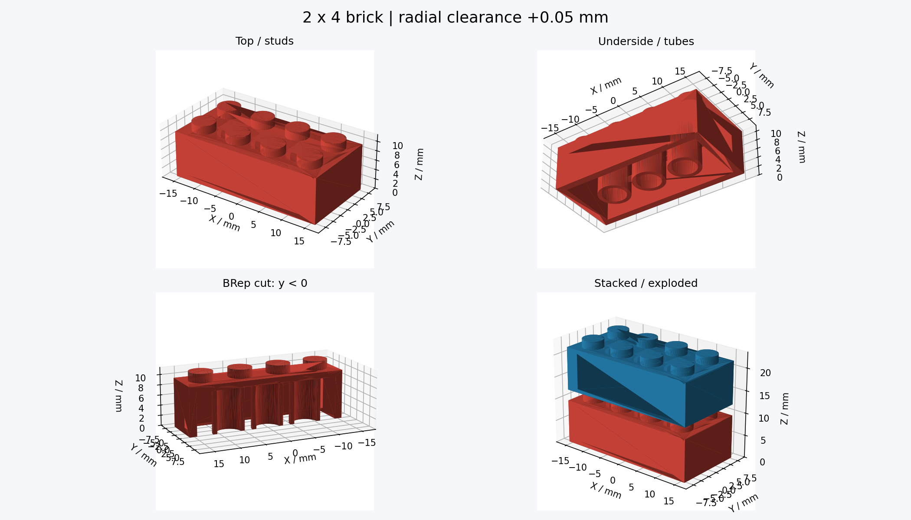

# 3d-printer — ブロック設計・検証ハーネス

変則ブロックを作るための、パラメトリックCADと幾何検証の作業環境です。まずは2×4のレゴ互換を目指す試作品から始めます。**実物での嵌合は未検証**です。



## できること

- Pythonから寸法を変更して、裏面チューブ付きのブロックを生成。
- STL（印刷用）とSTEP（CAD編集用）を書き出し、ファイル自体も検査。
- CADの単一実体・寸法・体積・開口・スタッド・チューブを検査。
- 重ねる・1ピッチずらす・90度交差する姿勢で、BRepの共通体積を計算。
- 挿入方向の5姿勢と、公差の違う5候補を確認。
- 実際の形状の断面PNGと、オフラインで回転できるHTMLを生成。
- GitHub Actionsで再検証し、STL/STEP/HTML/レポート一式をartifactに保存。

## 最初の試作品を見る

`examples/first-print/`に生成済みの一式を置いています。

- [`brick.stl`](examples/first-print/brick.stl) — 半径方向+0.05 mmの未校正候補。
- [`brick.step`](examples/first-print/brick.step) — 他CADへ渡す形状。
- [`viewer.html`](examples/first-print/viewer.html) — ダウンロードしてブラウザで開く。GitHub上の表示はソースコードです。
- [`report.json`](examples/first-print/report.json) — 寸法、検証結果、干渉量、使用バージョン、出力ハッシュ。
- [`calibration/`](examples/first-print/calibration/) — 5種類の試し刷りSTLと実測用テンプレート。

`preview.png`の組立図は見やすいように2.5 mm浮かせています。HTMLでは追加高さ0 mmに戻して組立状態を確認できます。相手は合成の名目モデルです。純正をスキャン・実測したものではありません。

## 再生成

Python 3.11を使用します。MacではまずPython 3.11を用意し、以下をrepoのルートで実行してください。

```sh
python3.11 -m venv .venv
source .venv/bin/activate
python -m pip install -r requirements.txt
python -m unittest discover -s tests -v
python -m brickcad all
open build/first-print/viewer.html
```

Mac以外では最後のHTMLをブラウザで開いてください。主要なCAD・数値計算・描画依存はバージョン固定していますが、全推移依存のlockfileではありません。検証時の実バージョンはレポートに残します。

```sh
# 合成の名目寸法モデル
python -m brickcad build --profile profiles/nominal.json --out build/nominal

# 公差5候補のSTL・比較結果・計測テンプレートだけ生成
python -m brickcad sweep --profile profiles/first-print.json --out build/trial
```

寸法変更はJSON profileを追加して`--profile`で指定します。省略した項目は`brickcad/model.py`の既定値です。現在の対応範囲は両軸2〜12スタッドの長方形です。例えば2×3は`{"nx":3,"ny":2,"clearance":0.05}`。

```text
brickcad/model.py       CAD生成・寸法定義
brickcad/verify.py      BRep・STL・組立の検証
brickcad/render.py      CAD断面画像・HTML生成
brickcad/viewer.html    外部ライブラリ不要の3D表示
brickcad/__main__.py    build / sweep / all
profiles/              名目設定と初回印刷候補
examples/first-print/  生成済み試作品・検証結果
measurements/          実測記録（取得後に追加）
tests/                 正常例・欠陥を検出する負例
```

## 「検証済み」の意味

`report.json`の`passed=true`は、CAD/STL/STEPの検査、検査した組立姿勢の無干渉、負例の検出を通ったという意味です。締まり具合・保持力・印刷精度の保証ではありません。負の公差で意図的に食い込ませた候補は、sweep内では正常に生成されても干渉ありと報告します。

次の段階ではプリンター機種・ノズル・材料・スライサーを特定し、試し刷りの実測値からprofileを調整します。[設計の根拠・検証範囲・実測手順](docs/design.md)を参照してください。
