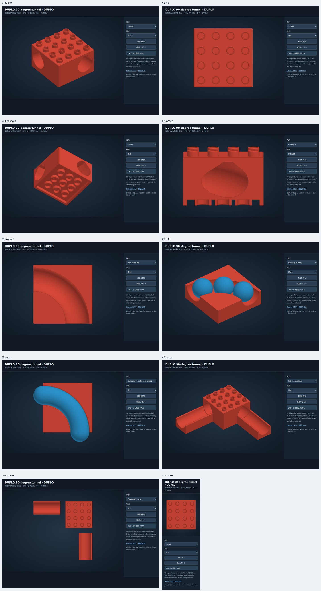

# M1：90度の隠しトンネル 試作01

Issue #3の「ボールがDUPLOの内部に消え、別の場所から出る」を広げる新しい印刷形状。直線トンネル試作01とは別のモデルです。4×4ポッチの塊の中を90度曲がります。上下に通常DUPLO、横に既存レールを接続する設計です。

- [印刷用ZIP](../prints/duplo_elbow_trial_01.zip)：`duplo_elbow_4x4_trial_01.stl`を**1個**印刷。
- [STL単体](../examples/duplo-elbow-trial-01/brick.stl)、[STEP](../examples/duplo-elbow-trial-01/brick.step)、[CAD検証JSON](../examples/duplo-elbow-trial-01/report.json)。
- [実ブラウザ10視点](../examples/duplo-elbow-trial-01/review-sheet.jpg)、[画像確認記録](../examples/duplo-elbow-trial-01/visual-review.md)。



## 寸法と既存モデルとの関係

| 項目 | mm / 内容 |
|---|---|
| 外形 | 63.8 × 63.8、4×4ポッチ |
| 本体高さ / 突起込み | 38.4 / 42.9 |
| 通路中心線 | 水平の90度円弧、R48 |
| 通路底の高さ | 6.35（直線トンネル・水平レールと同じ） |
| 通路底断面の半径 | 約12.8703、既存と同じ |
| 検査対象の球 | 参考実測径24.26 |
| 屋根 | 45度斜面＋約5.24幅の短い天井ブリッジ |
| 受けの空洞高さ / 走行面下の厚さ | 4.75 / 1.60 |
| 天井上の厚さ | 3.60 |
| 丸め | 外角R0.8、突起上端R0.5、開口0.3面取り |

**裏面が緩い件は未解決です。** 既存試作の受け（チューブ外径13.30、内径9.40、壁3.16）を継承しています。報告されたレール実測は外径約13.01、内径約8.93で、単一の測定から全面的な補正を確定しません。受けの保持力と新しい通路の成立性を区別します。上面突起外径9.20も未校正の試作値です。

## ポートと組み方

座標は本体中心XY、底面Z=0、16 mmグリッド。入出力は逆転してもよく、両口とも水平です。

| 部位 | 走行面基準点XYZ | 外向き法線 |
|---|---|---|
| 西口 | (-32, -16, 6.35) | (-1, 0, 0) |
| 北口 | (16, 32, 6.35) | (0, 1, 0) |

上下に並べた4×4ポッチの中央に口があるのではなく、**片側に16 mmずれたレーン位置**です。曲がり半径と側壁を確保し、DUPLOの突起グリッドにも揃えるためです。対向する西東の直線通路はありません。

同梱しない既存水平レールを接続する場合：入口レール中心=(-64,-16,0)、出口レール中心=(16,64,0)、出口レールはZ軸90度回転。`assembly.step`はこの3部品の参照組立で、**一体印刷用ではありません**。既存レール2個があれば、今回追加で必要な印刷はトンネル1個だけです。

通常DUPLOを広く敷いて各部品の底面を同じ高さに支えます。受けが緩い可能性があるため、軽く揺らしても外れないことを先に確認してください。ポートの0.2 mmの継ぎ目は名目グリッド隙間で、横方向のロック機構はありません。

## 印刷

1. ZIPから`duplo_elbow_4x4_trial_01.stl`をBambu Studio等へ読み込む。**mm・100%**。向きは突起が上、裏面開口がプレート側。63.8×63.8×42.9 mmであることを確認。
2. これまで試作した材料・ノズル設定から始め、積層0.20 mm、外周3以上、インフィル15〜20%を初期候補にする。未スライスなので造形時間・使用量はスライサーで確認。G-codeは提供しない。
3. 内部通路はサポートを取り出しにくいため、**内部サポートを生成しない**。45度屋根と短い天井ブリッジ、裏面の橋渡しをレイヤープレビューで確認する。上面・底面層数は使用プロファイルで確認し、1.6 mmの通路床を保つ。
4. 初回は1個だけ。冷却後に外し、両口の糸引き・バリ・屋根の垂れを確認する。無理に球を押し込まない。

この試作は内部を開閉しない一体物です。ビューアーの「Roof removed」はCAD断面表示であり、取り外せる蓋ではありません。途中停止したら部品を外して傾け、両口から回収します。取り出せない場合は使用を止め、無理に硬い棒を押し込まず、詰まった位置を記録します。

## 実物で確認してほしいこと

1. 純正の上に本品／本品の上に純正の2方向の嵌合。きつい・適度・緩い・保持しないを分ける。
2. 組み込む前に本品を少し傾け、球が両方向から通ることを各10回確認。これは水平運用の成功判定とは分ける。
3. 底面を水平にし、入口に既存レールをつなぐ。上流の坂から球を放し、停止・脱線・出口までの到達を両方向10回ずつ記録。上流の高さ、坂、球の種類、毎回の放し方を揃える。
4. 止まる場所（入口継ぎ目／曲がりの途中／出口）、球の回収のしやすさ、受けの外れ、バリや内部の垂れを記録。

水平の曲がりには入口の勢いが必要です。球を置くだけで自走する設計ではありません。曲がりによる減速・壁接触・実物の段差はCAD検査では判定していません。必要な勢いが大きすぎれば、次版で高低差や曲率を検討します。

約24 mmの球を乳幼児の手の届く場所に置かず、成人が管理して試験します。安全確認済みの子ども向け完成品ではありません。

## 再生成・検証

```sh
python -m brickcad.elbow
python -m unittest discover -s tests -v
python -m brickcad all
# ブラウザ導入は docs/new-session.md に従う
node scripts/elbow-browser-check.cjs
python scripts/review-sheet.py build/elbow-browser
```

CadQuery BRepを正とし、円弧通路は断面を90度回転して生成。球は球中心の円弧に沿う正確なトーラス掃引＋両端球、接続する2本のレールは円筒を合成し、全コースとの干渉を検査します。離散球配置だけの検査ではありません。直径28 mm、走行面1 mm上昇、横4 mmずれの実形状が干渉する負例も検査。球中心の0.05 mm浮きは数値用で、実測値ではありません。

STLは線形公差0.03 mm・角度公差0.2 radで書き出し、閉じた向き付きメッシュ・体積を検査。STEPは単一ソリッド・寸法・相対体積差1e-7以下を検査します。今回のSTEP再読込体積差は約0.000651 mm³（元体積約104,536 mm³）です。これは単位・数値精度検査で、印刷精度の意味はありません。

大きな生成HTML・フル解像度PNGは`build/`に保存。追跡対象のソースとSTL/STEP・検証JSON・画像一覧から再生成できます。CAD PASSとは別に`physical_fit_validated=false`、`physical_rolling_validated=false`を維持します。
