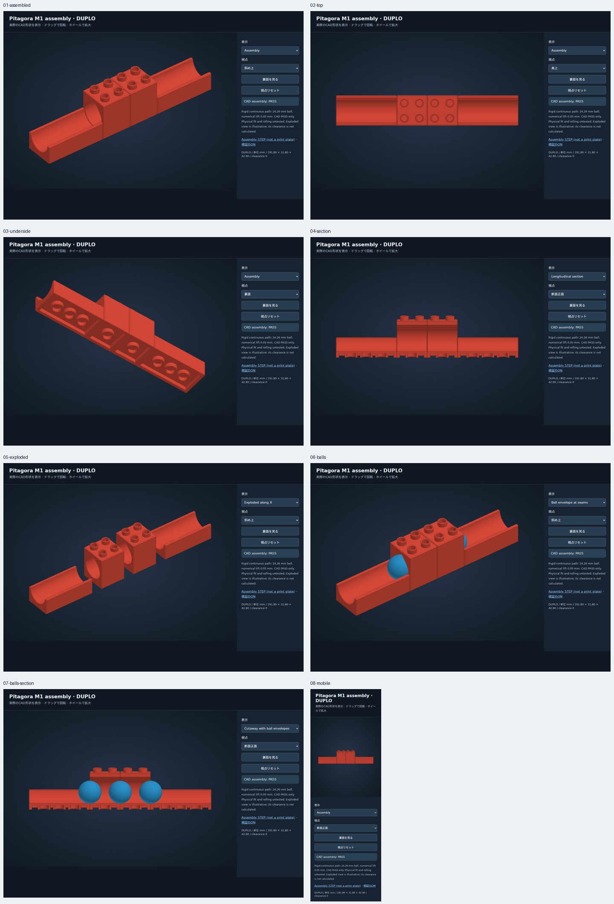

# ピタゴラ M1：隠し通路の連結を確認する最初の区切り

親Issue #3 の最初の独立マイルストーン。既存のレールと直線2段トンネルを再利用し、**レール → トンネル2個 → レール**を16 mmグリッドで接続した。新しい接続補正や新形状は追加していない。子どもがブロックで配置を変える遊びの土台として、継ぎ目も含む通過検証と、実物試験に渡せる組立を整える。



## 接続ポート v0

単位mm、右手系、Z上向き、底面の座面 Z=0。各部品の中心をXY原点とする。`brickcad/ports.py` の `Port` は球の走行面の基準点と外向き単位法線を持つ。入口／出口の役割はコース側で決める。左右どちらからでも通過する水平モジュールである。

| 項目 | 今回の定義 |
|---|---|
| グリッド | 16 mm、長手方向の占有はレール4セル／トンネル2セル |
| ポート位置 | 実際の開口端でなく占有セルの境界面 |
| レールの左右基準点 | (−32, 0, 6.35), (+32, 0, 6.35) |
| トンネルの左右基準点 | (−16, 0, 6.35), (+16, 0, 6.35) |
| 外向き法線 | 左=(−1,0,0)、右=(+1,0,0) |
| 走行面の円弧 | 既存 `Rail().radius` を継承、約12.8703 mm |
| 開口端の後退 | グリッド境界から各0.1 mm、向かい合う本体間は0.2 mm |
| 球径 | 24.26 mm（既存の概測値、確定仕様ではない） |
| 検査球の中心線 | (X, 0, 6.35 + 12.13 + 0.05) = (X, 0, 18.53) |

円弧は実物断面を確定したものではなく、#2 の寸法を基にした既存仮説。0.05 mmは接触による数値不安定を避ける検査上の逃げで、実物の浮き量ではない。ポート同士の基準点一致・逆向き法線・円弧半径一致を判定する。公差1e−6 mmは座標比較用で、造形精度ではない。レールは開放溝、トンネルは屋根付きなので、同じ円弧でも上側の断面は異なる。通過可能性はポート情報だけで断定せず実CADで別途検査する。

位置はXYZ、法線は3成分。今回の配置関数はZ軸周りの回転と平行移動のみ。坂やリフトには各出口の高さ・方向・実断面と搬送経路の検証を追加する。すべての将来部品を水平・同一高度に制限する規格ではない。

## 組立位置

| 部品 | 中心XYZ | 用意する既存モデル |
|---|---|---|
| 入口レール | (−64,0,0) | rail trial 01 ×1 |
| 隠し通路1 | (−16,0,0) | tunnel trial 01 ×1 |
| 隠し通路2 | (+16,0,0) | tunnel trial 01 ×1 |
| 出口レール | (+64,0,0) | rail trial 01 ×1 |

占有12×2ポッチ、占有長192 mm、本体長191.8 mm、最大高さ42.9 mm。全4部品を同じ底面高さで固定する。通常DUPLOや基板を使って全体を同じグリッドへ支持する。レール本体高さ19.13 mmと通常DUPLOの19.2 mmの差を、床高さ6.35 mmと混同しない。今回の組立CADは支持ブロックを含まない。保持力・支持構成は実物試験で確認する。

## 検証内容と限界

`python -m brickcad.pitagora` で組立STEP、検証JSON、自己完結型HTMLビューアーを生成する。構成・ポートとCAD環境、STEPのSHA-256をJSONへ残す。

- 各部品の有効な単一BRep、全6組の本体間の非干渉、3つのポート接続。
- 全長に球半径分の余長を足した円筒で、各部品に対する**連続掃引**を検査。端面と3か所の継ぎ目を含む。これは掃引球を包含する保守的な検査であり、球の静止位置の間の干渉も見逃さない。
- トンネルを1 mm持ち上げたCAD、横に4 mmずらしたCAD、直径28 mmの球を負例にして、検査が干渉を検出することを確認。
- メタデータだけの高さずれと、ポート情報を変えずにCADだけをずらした欠陥もテスト。
- 組立STEP再読込で4ソリッド・体積一致。既存の各部品のSTL検査は元のモジュール／テストで継続する。
- 実Chromiumで組立・上・裏・断面・分解・球・球付き断面・スマホ表示を撮影。分解は見せ方のための移動で、分解経路の干渉検証ではない。

CADのPASSは、摩擦、転がり、印刷後の段差、勢い、純正レールとの接続、受けの締まりを保証しない。既存の受けチューブ13.30 mm・突起9.20 mmは未検証の調整案で、合成基準との受け側干渉も維持している。`physical_fit_validated=false`、`physical_rolling_validated=false`。

## 再生成・表示

依存とブラウザの準備は [new-session.md](new-session.md) を参照。

```sh
python -m unittest discover -s tests -v
python -m brickcad all
python -m brickcad.pitagora
npm run browser:interactive -- build/pitagora-m1
node scripts/pitagora-browser-check.cjs build/pitagora-m1 build/pitagora-browser
python scripts/review-sheet.py build/pitagora-browser
```

Linux代替Chromiumでは、上のブラウザコマンドへ `BRICK_CHROMIUM_PACKAGE` を付ける。生成HTMLの表示で組立／断面／球付き断面／分解を選べる。組立STEPは他CADへ渡すためのファイルで、印刷プレートではない。

## 次に印刷して確認すること

1. まず既存の [2段トンネル試作01](duplo-tunnel-trial-01.md) を1個試す。上下の接続、バリ・内部造形・球の単体通過を確認してから複数へ進む。
2. [レール試作01](duplo-rail-trial-01.md) を2個、トンネル試作01を合計2個用意する。各リンク先のSTL ZIPを使う。単位mm・100%。このPRは新たな印刷形状を増やさない。
3. 上表どおり通常DUPLO上へ固定し、底面高さとグリッドをそろえる。端面同士を無理に密着させない。純正品での受けと突起の嵌合は別々に評価する。
4. 水平通路は自走しないため、同じ上流コースの同じ位置から球を離す。上流コースの高さ・形状を記録する。球を押す場合は参考試験として分けて記録する。
5. 左→右・右→左を各10回。入口、各継ぎ目、出口の停止回数と位置、通過数、脱線、固定部の外れを記録する。途中で詰まったら原因を調べ、強く押し込んで通過扱いにしない。10/10はこの条件での試作目標で、品質保証ではない。
6. `measurements/templates/pitagora-m1.json` を別名コピーし、プリンター・材料・層高・球実測・試験条件・結果を記入して次の変更へ戻す。テンプレートのnullは未測定である。

約24 mmの球を使うため、乳幼児が触れたり放置された球を拾ったりできない環境で成人が試験する。角・バリ・詰まり・支持の安全確認前の試作品である。

## 今回以降

最初の実物通過・上下嵌合の結果を#1/#2へ還元する。次の独立PRはM2の2球共通スタートゲート。90度トンネル、ゴール判定、手回しリフト、重り駆動は親Issue #3 に残す。このマイルストーンで親Issue全体は完了しない。


## 新しい印刷モデル：90度版

直線コースの次のM1試作として、[4×4ポッチ・90度の隠しトンネル試作01](duplo-elbow-trial-01.md)を追加。新しいSTLを1個印刷し、既存レールを直角に接続して評価できます。直線トンネル試作01と別形状で、通路底高さ・断面・16 mmグリッドを共有します。実物通過は未検証です。
